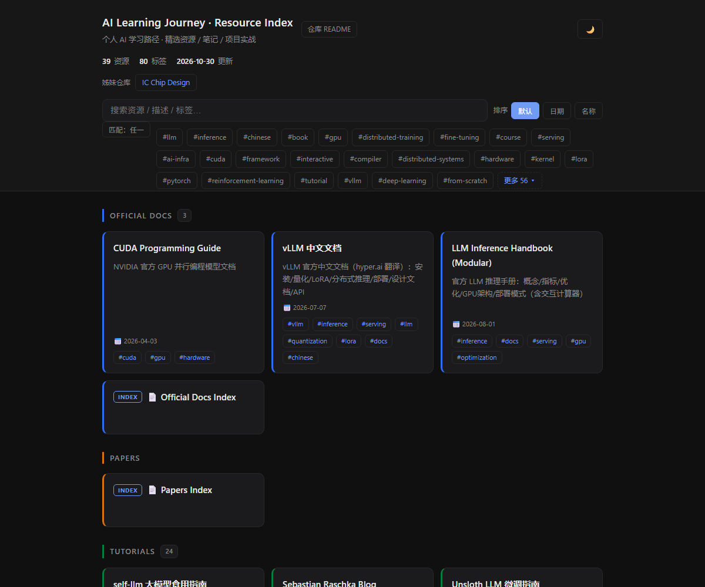
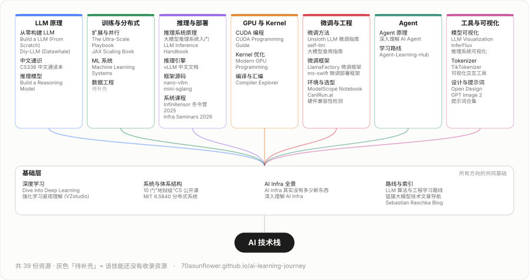
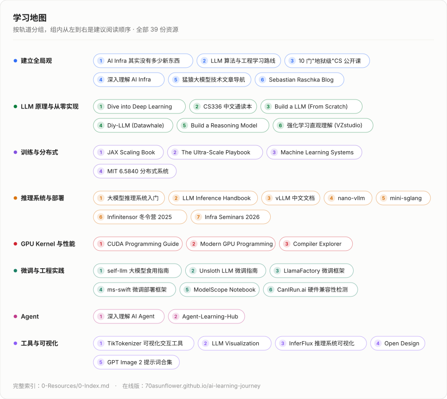

<h1 align="center">AI Learning Journey</h1>

<p align="center">
  个人 AI 学习路径 · 精选资源 / 笔记 / 项目实战<br>
  <sub>每条资源都带中文摘要与要点，点开即可在线阅读</sub>
</p>

<p align="center">
  <a href="https://70asunflower.github.io/ai-learning-journey/"><b>🌐 在线索引</b></a>
  &nbsp;·&nbsp;
  <a href="0-Resources/0-Index.md">📚 全部资源</a>
  &nbsp;·&nbsp;
  <a href="CONTRIBUTING.md">🛠 参与维护</a>
  &nbsp;·&nbsp;
  <a href="https://70asunflower.github.io/ic-chip-design-learning/">🔌 姊妹仓库</a>
</p>

<p align="center">
  <a href="https://70asunflower.github.io/ai-learning-journey/">
    
  </a>
</p>

## 🧭 技术栈树

<p align="center">
  <a href="https://70asunflower.github.io/ai-learning-journey/">
    <picture>
      <source media="(prefers-color-scheme: dark)" srcset="assets/skilltree-dark.svg">
      
    </picture>
  </a>
</p>

<details>
<summary>文本版（可点击跳转）</summary>

<!-- BUILD:TREE:START -->
**基础层**（所有方向的共同基础）

- 深度学习 — [Dive into Deep Learning](0-Resources/3-Tutorials/dive-into-deep-learning.md) · [强化学习直观理解 (VZstudio)](0-Resources/3-Tutorials/rl-intuitive-explanation-vzstudio.md)
- 系统与体系结构 — [10 门"地狱级"CS 公开课](0-Resources/3-Tutorials/top-10-hell-level-cs-courses.md) · [MIT 6.5840 (原 6.824) 分布式系统](0-Resources/3-Tutorials/mit-65840-distributed-systems.md)
- AI Infra 全景 — [AI Infra 其实没有多少新东西](0-Resources/3-Tutorials/ai-infra-nothing-new.md) · [深入理解 AI Infra](0-Resources/3-Tutorials/bojieli-ai-infra-book.md)
- 路线与索引 — [LLM 算法与工程学习路线](0-Resources/3-Tutorials/llm-algorithm-engineering-roadmap.md) · [猛猿大模型技术文章导航](0-Resources/3-Tutorials/mengyuan-llm-articles-index.md) · [Sebastian Raschka Blog](0-Resources/3-Tutorials/sebastian-raschka-blog.md)

**LLM 原理**

- 从零构建 LLM — [Build a LLM (From Scratch)](0-Resources/3-Tutorials/llms-from-scratch.md) · [Diy-LLM (Datawhale)](0-Resources/3-Tutorials/datawhale-diy-llm.md)
- 中文通识 — [CS336 从零构建语言模型 (中文)](0-Resources/3-Tutorials/cs336-language-modeling-from-scratch.md)
- 推理模型 — [Build a Reasoning Model (From Scratch)](0-Resources/3-Tutorials/reasoning-from-scratch.md)

**训练与分布式**

- 扩展与并行 — [The Ultra-Scale Playbook](0-Resources/3-Tutorials/ultrascale-playbook.md) · [JAX Scaling Book](0-Resources/3-Tutorials/jax-scaling-book.md)
- ML 系统 — [Machine Learning Systems (Harvard CS249r)](0-Resources/3-Tutorials/machine-learning-systems-book.md)
- 数据工程 — _待补充_

**推理与部署**

- 推理系统原理 — [大模型推理系统入门](0-Resources/3-Tutorials/llm-inference-system-intro.md) · [LLM Inference Handbook (Modular)](0-Resources/1-Official-Docs/llm-inference-handbook.md)
- 推理引擎 — [vLLM 中文文档](0-Resources/1-Official-Docs/vllm-docs-zh.md)
- 框架源码 — [nano-vllm](0-Resources/4-Tools-Frameworks/nano-vllm.md) · [mini-sglang](0-Resources/4-Tools-Frameworks/mini-sglang.md)
- 系统课程 — [Infinitensor 冬令营 2025](0-Resources/3-Tutorials/infinitensor-winter-camp-2025.md) · [Infra Seminars 2026](0-Resources/3-Tutorials/infra-seminars-2026.md)

**GPU 与 Kernel**

- CUDA 编程 — [CUDA Programming Guide](0-Resources/1-Official-Docs/cuda-programming-guide.md)
- Kernel 优化 — [Modern GPU Programming For MLSys](0-Resources/3-Tutorials/mlc-modern-gpu-programming.md)
- 编译与汇编 — [Compiler Explorer (Godbolt)](0-Resources/4-Tools-Frameworks/compiler-explorer.md)

**微调与工程**

- 微调方法 — [Unsloth LLM 微调指南](0-Resources/3-Tutorials/unsloth-fine-tuning-guide.md) · [self-llm 大模型食用指南](0-Resources/3-Tutorials/self-llm.md)
- 微调框架 — [LlamaFactory 微调框架](0-Resources/4-Tools-Frameworks/llamafactory.md) · [ms-swift 微调部署框架](0-Resources/4-Tools-Frameworks/ms-swift.md)
- 环境与选型 — [ModelScope Notebook 免费试用](0-Resources/4-Tools-Frameworks/modelscope-notebook.md) · [CanIRun.ai 硬件兼容性检测](0-Resources/4-Tools-Frameworks/canirun.md)

**Agent**

- Agent 原理 — [深入理解 AI Agent](0-Resources/3-Tutorials/bojieli-ai-agent-book.md)
- 学习路线 — [Agent-Learning-Hub (Datawhale)](0-Resources/3-Tutorials/agent-learning-hub.md)

**工具与可视化**

- 模型可视化 — [LLM Visualization (bbycroft)](0-Resources/4-Tools-Frameworks/llm-viz.md) · [InferFlux 推理系统可视化](0-Resources/4-Tools-Frameworks/inferflux.md)
- Tokenizer — [TikTokenizer 可视化交互工具](0-Resources/4-Tools-Frameworks/tiktokenizer.md)
- 设计与提示词 — [Open Design](0-Resources/4-Tools-Frameworks/open-design.md) · [GPT Image 2 提示词合集](0-Resources/4-Tools-Frameworks/gpt-image-2-prompts.md)
<!-- BUILD:TREE:END -->

</details>

## ✨ 从这里开始

<p align="center">
  <a href="https://70asunflower.github.io/ai-learning-journey/">
    <picture>
      <source media="(prefers-color-scheme: dark)" srcset="assets/roadmap-dark.svg">
      
    </picture>
  </a>
</p>

<details>
<summary>文本版（可点击跳转）</summary>

<!-- BUILD:MAP:START -->
**1. 建立全局观**

- [AI Infra 其实没有多少新东西](0-Resources/3-Tutorials/ai-infra-nothing-new.md) — 腾讯云出品：硬件演进/PCA解耦/训练推理Infra，附PDF
- [LLM 算法与工程学习路线](0-Resources/3-Tutorials/llm-algorithm-engineering-roadmap.md) — 从算法/分布式训练/推理部署/评估的完整路线，含优先级分层
- [10 门"地狱级"CS 公开课](0-Resources/3-Tutorials/top-10-hell-level-cs-courses.md) — MIT/CMU/Stanford 顶尖 CS 系统课合集（数据库/分布式/OS/编译/AI系统）
- [深入理解 AI Infra](0-Resources/3-Tutorials/bojieli-ai-infra-book.md) — 李博杰开源书：数据搬移主线 + 量化估算方法论，12 章覆盖加速器/推理/训练/网络/调度
- [猛猿大模型技术文章导航](0-Resources/3-Tutorials/mengyuan-llm-articles-index.md) — 知乎猛猿图解 LLM 系列总索引：训练并行/微调/RLHF/推理加速/扩散/多模态
- [Sebastian Raschka Blog](0-Resources/3-Tutorials/sebastian-raschka-blog.md) — 深度学习、LLM、PyTorch 技术博客

**2. LLM 原理与从零实现**

- [Dive into Deep Learning](0-Resources/3-Tutorials/dive-into-deep-learning.md) — 交互式深度学习教材，可执行 Jupyter Notebook，多框架实现（PyTorch/JAX/TF）
- [CS336 从零构建语言模型 (中文)](0-Resources/3-Tutorials/cs336-language-modeling-from-scratch.md) — 斯坦福 CS336 全17讲中文通识读本：分词→预训练→对齐
- [Build a LLM (From Scratch)](0-Resources/3-Tutorials/llms-from-scratch.md) — Sebastian Raschka 著，从零构建 ChatGPT 级 LLM（92k+ Stars）
- [Diy-LLM (Datawhale)](0-Resources/3-Tutorials/datawhale-diy-llm.md) — CS336 中文本土化实现课：16 章理论 + 6 个渐进代码作业，从手搓 tokenizer 到 GRPO
- [Build a Reasoning Model (From Scratch)](0-Resources/3-Tutorials/reasoning-from-scratch.md) — Sebastian Raschka 著，推理型 LLM 构建（GRPO/蒸馏/推理时扩展）
- [强化学习直观理解 (VZstudio)](0-Resources/3-Tutorials/rl-intuitive-explanation-vzstudio.md) — 小鸡啄托盘得奖励——RL 直观体现，连接 RLHF 对齐

**3. 训练与分布式**

- [JAX Scaling Book](0-Resources/3-Tutorials/jax-scaling-book.md) — JAX 官方 LLM Scaling 实战书籍，分布式训练全链路
- [The Ultra-Scale Playbook](0-Resources/3-Tutorials/ultrascale-playbook.md) — HF/nanotron 出品：从单卡到 512 GPU 的 LLM 训练扩展实战（DP/TP/PP/CP/EP + ZeRO + 混合精度）
- [Machine Learning Systems (Harvard CS249r)](0-Resources/3-Tutorials/machine-learning-systems-book.md) — MIT Press 2026 两卷本：单机→fleet 规模 28 章，配 TinyTorch/MLSys·im/Labs 生态
- [MIT 6.5840 (原 6.824) 分布式系统](0-Resources/3-Tutorials/mit-65840-distributed-systems.md) — MIT PDOS 研究生核心课：Raft/MapReduce/一致性，5 个硬核 Go lab

**4. 推理系统与部署**

- [大模型推理系统入门](0-Resources/3-Tutorials/llm-inference-system-intro.md) — 从模型优化到调度优化：PagedAttention/Continuous Batching/Speculative Decoding
- [LLM Inference Handbook (Modular)](0-Resources/1-Official-Docs/llm-inference-handbook.md) — 官方 LLM 推理手册：概念/指标/优化/GPU架构/部署模式（含交互计算器）
- [vLLM 中文文档](0-Resources/1-Official-Docs/vllm-docs-zh.md) — vLLM 官方中文文档（hyper.ai 翻译）：安装/量化/LoRA/分布式推理/部署/设计文档/API
- [nano-vllm](0-Resources/4-Tools-Frameworks/nano-vllm.md) — 极简 vLLM 实现，学习推理框架核心原理（PagedAttention/Continuous Batching）
- [mini-sglang](0-Resources/4-Tools-Frameworks/mini-sglang.md) — 极简 SGLang 实现，学习推理框架另一技术路线（RadixAttention/前缀缓存）
- [Infinitensor 冬令营 2025](0-Resources/3-Tutorials/infinitensor-winter-camp-2025.md) — 推理 infra 全栈训练营，覆盖模型层/框架层/算子层
- [Infra Seminars 2026](0-Resources/3-Tutorials/infra-seminars-2026.md) — LCPU 出品 AI 基础设施系列课：Kernel&编译器 / 互联通信 / 推理服务 / 分布式 RL

**5. GPU Kernel 与性能**

- [CUDA Programming Guide](0-Resources/1-Official-Docs/cuda-programming-guide.md) — NVIDIA 官方 GPU 并行编程模型文档
- [Modern GPU Programming For MLSys](0-Resources/3-Tutorials/mlc-modern-gpu-programming.md) — MLC.ai/CMU 出品：Blackwell GPU Kernel 实战（TMA/Warp Spec/FlashAttention 4）
- [Compiler Explorer (Godbolt)](0-Resources/4-Tools-Frameworks/compiler-explorer.md) — 在线编译器探索：实时汇编/LLVM IR/优化管线，多编译器对比，验证向量化

**6. 微调与工程实践**

- [self-llm 大模型食用指南](0-Resources/3-Tutorials/self-llm.md) — DataWhale 社区维护的中文开源大模型入门教程，覆盖环境配置、部署使用、高效微调全流程
- [Unsloth LLM 微调指南](0-Resources/3-Tutorials/unsloth-fine-tuning-guide.md) — Unsloth 官方中文教程，LoRA/QLoRA 高效微调全流程
- [LlamaFactory 微调框架](0-Resources/4-Tools-Frameworks/llamafactory.md) — 100+ LLM/VLM 高效微调框架，支持 LoRA/QLoRA/SFT/DPO
- [ms-swift 微调部署框架](0-Resources/4-Tools-Frameworks/ms-swift.md) — 魔搭社区大模型与多模态模型全链路框架，覆盖训练→推理→评测→量化→部署
- [ModelScope Notebook 免费试用](0-Resources/4-Tools-Frameworks/modelscope-notebook.md) — 魔搭云上开发环境，开箱即用 GPU/CPU，提供免费使用时长
- [CanIRun.ai 硬件兼容性检测](0-Resources/4-Tools-Frameworks/canirun.md) — 检测本地 GPU/VRAM/RAM 能跑哪些本地大模型，支持 llama.cpp/Ollama/LM Studio 数据源

**7. Agent**

- [深入理解 AI Agent](0-Resources/3-Tutorials/bojieli-ai-agent-book.md) — 李博杰开源书 45k+★：Agent = LLM + 上下文 + 工具，Harness 工程才是竞争力
- [Agent-Learning-Hub (Datawhale)](0-Resources/3-Tutorials/agent-learning-hub.md) — AI Agent 学习路线，2.9k⭐，8阶段+11项目，可执行清单

**8. 工具与可视化**

- [TikTokenizer 可视化交互工具](0-Resources/4-Tools-Frameworks/tiktokenizer.md) — 可视化学习 LLM Tokenizer 工作原理的交互工具 (GPT2/CL100K 等编码器)
- [LLM Visualization (bbycroft)](0-Resources/4-Tools-Frameworks/llm-viz.md) — GPT 风格 LLM 推理 3D 交互可视化，逐层看注意力/FFN/词元流动（WebGL）
- [InferFlux 推理系统可视化](0-Resources/4-Tools-Frameworks/inferflux.md) — 零依赖交互式动画：PD分离模拟/吞吐计算/3D请求生命周期/GPU集合通信（Three.js）
- [Open Design](0-Resources/4-Tools-Frameworks/open-design.md) — Claude Design 开源替代，AI 驱动 artifact-first 设计工具（13 CLI/31 Skills/129 设计系统）
- [GPT Image 2 提示词合集](0-Resources/4-Tools-Frameworks/gpt-image-2-prompts.md) — 725+ 精选提示词，JSON 结构化+参数化模板（产品海报/信息图/UI设计/动漫插画）
<!-- BUILD:MAP:END -->

</details>

## 🗂️ 资源导航

<!-- BUILD:NAV:START -->
<details open>
<summary><b>📚 Resources</b></summary>

<details>
<summary>1-Official Docs</summary>

- [CUDA Programming Guide](0-Resources/1-Official-Docs/cuda-programming-guide.md) — NVIDIA 官方 GPU 并行编程模型文档
- [vLLM 中文文档](0-Resources/1-Official-Docs/vllm-docs-zh.md) — vLLM 官方中文文档（hyper.ai 翻译）：安装/量化/LoRA/分布式推理/部署/设计文档/API
- [LLM Inference Handbook (Modular)](0-Resources/1-Official-Docs/llm-inference-handbook.md) — 官方 LLM 推理手册：概念/指标/优化/GPU架构/部署模式（含交互计算器）
- [📄 Official Docs Index](0-Resources/1-Official-Docs/README.md)

</details>

<details>
<summary>2-Papers</summary>

- [📄 Papers Index](0-Resources/2-Papers/README.md)

</details>

<details>
<summary>3-Tutorials</summary>

- [self-llm 大模型食用指南](0-Resources/3-Tutorials/self-llm.md) — DataWhale 社区维护的中文开源大模型入门教程，覆盖环境配置、部署使用、高效微调全流程
- [Sebastian Raschka Blog](0-Resources/3-Tutorials/sebastian-raschka-blog.md) — 深度学习、LLM、PyTorch 技术博客
- [Unsloth LLM 微调指南](0-Resources/3-Tutorials/unsloth-fine-tuning-guide.md) — Unsloth 官方中文教程，LoRA/QLoRA 高效微调全流程
- [10 门"地狱级"CS 公开课](0-Resources/3-Tutorials/top-10-hell-level-cs-courses.md) — MIT/CMU/Stanford 顶尖 CS 系统课合集（数据库/分布式/OS/编译/AI系统）
- [LLM 算法与工程学习路线](0-Resources/3-Tutorials/llm-algorithm-engineering-roadmap.md) — 从算法/分布式训练/推理部署/评估的完整路线，含优先级分层
- [Infinitensor 冬令营 2025](0-Resources/3-Tutorials/infinitensor-winter-camp-2025.md) — 推理 infra 全栈训练营，覆盖模型层/框架层/算子层
- [JAX Scaling Book](0-Resources/3-Tutorials/jax-scaling-book.md) — JAX 官方 LLM Scaling 实战书籍，分布式训练全链路
- [Build a LLM (From Scratch)](0-Resources/3-Tutorials/llms-from-scratch.md) — Sebastian Raschka 著，从零构建 ChatGPT 级 LLM（92k+ Stars）
- [Build a Reasoning Model (From Scratch)](0-Resources/3-Tutorials/reasoning-from-scratch.md) — Sebastian Raschka 著，推理型 LLM 构建（GRPO/蒸馏/推理时扩展）
- [Dive into Deep Learning](0-Resources/3-Tutorials/dive-into-deep-learning.md) — 交互式深度学习教材，可执行 Jupyter Notebook，多框架实现（PyTorch/JAX/TF）
- [Agent-Learning-Hub (Datawhale)](0-Resources/3-Tutorials/agent-learning-hub.md) — AI Agent 学习路线，2.9k⭐，8阶段+11项目，可执行清单
- [大模型推理系统入门](0-Resources/3-Tutorials/llm-inference-system-intro.md) — 从模型优化到调度优化：PagedAttention/Continuous Batching/Speculative Decoding
- [强化学习直观理解 (VZstudio)](0-Resources/3-Tutorials/rl-intuitive-explanation-vzstudio.md) — 小鸡啄托盘得奖励——RL 直观体现，连接 RLHF 对齐
- [AI Infra 其实没有多少新东西](0-Resources/3-Tutorials/ai-infra-nothing-new.md) — 腾讯云出品：硬件演进/PCA解耦/训练推理Infra，附PDF
- [Modern GPU Programming For MLSys](0-Resources/3-Tutorials/mlc-modern-gpu-programming.md) — MLC.ai/CMU 出品：Blackwell GPU Kernel 实战（TMA/Warp Spec/FlashAttention 4）
- [CS336 从零构建语言模型 (中文)](0-Resources/3-Tutorials/cs336-language-modeling-from-scratch.md) — 斯坦福 CS336 全17讲中文通识读本：分词→预训练→对齐
- [猛猿大模型技术文章导航](0-Resources/3-Tutorials/mengyuan-llm-articles-index.md) — 知乎猛猿图解 LLM 系列总索引：训练并行/微调/RLHF/推理加速/扩散/多模态
- [Infra Seminars 2026](0-Resources/3-Tutorials/infra-seminars-2026.md) — LCPU 出品 AI 基础设施系列课：Kernel&编译器 / 互联通信 / 推理服务 / 分布式 RL
- [The Ultra-Scale Playbook](0-Resources/3-Tutorials/ultrascale-playbook.md) — HF/nanotron 出品：从单卡到 512 GPU 的 LLM 训练扩展实战（DP/TP/PP/CP/EP + ZeRO + 混合精度）
- [MIT 6.5840 (原 6.824) 分布式系统](0-Resources/3-Tutorials/mit-65840-distributed-systems.md) — MIT PDOS 研究生核心课：Raft/MapReduce/一致性，5 个硬核 Go lab
- [深入理解 AI Agent](0-Resources/3-Tutorials/bojieli-ai-agent-book.md) — 李博杰开源书 45k+★：Agent = LLM + 上下文 + 工具，Harness 工程才是竞争力
- [深入理解 AI Infra](0-Resources/3-Tutorials/bojieli-ai-infra-book.md) — 李博杰开源书：数据搬移主线 + 量化估算方法论，12 章覆盖加速器/推理/训练/网络/调度
- [Machine Learning Systems (Harvard CS249r)](0-Resources/3-Tutorials/machine-learning-systems-book.md) — MIT Press 2026 两卷本：单机→fleet 规模 28 章，配 TinyTorch/MLSys·im/Labs 生态
- [Diy-LLM (Datawhale)](0-Resources/3-Tutorials/datawhale-diy-llm.md) — CS336 中文本土化实现课：16 章理论 + 6 个渐进代码作业，从手搓 tokenizer 到 GRPO
- [📄 Tutorials Index](0-Resources/3-Tutorials/README.md)

</details>

<details>
<summary>4-Tools & Frameworks</summary>

- [ModelScope Notebook 免费试用](0-Resources/4-Tools-Frameworks/modelscope-notebook.md) — 魔搭云上开发环境，开箱即用 GPU/CPU，提供免费使用时长
- [ms-swift 微调部署框架](0-Resources/4-Tools-Frameworks/ms-swift.md) — 魔搭社区大模型与多模态模型全链路框架，覆盖训练→推理→评测→量化→部署
- [TikTokenizer 可视化交互工具](0-Resources/4-Tools-Frameworks/tiktokenizer.md) — 可视化学习 LLM Tokenizer 工作原理的交互工具 (GPT2/CL100K 等编码器)
- [LlamaFactory 微调框架](0-Resources/4-Tools-Frameworks/llamafactory.md) — 100+ LLM/VLM 高效微调框架，支持 LoRA/QLoRA/SFT/DPO
- [CanIRun.ai 硬件兼容性检测](0-Resources/4-Tools-Frameworks/canirun.md) — 检测本地 GPU/VRAM/RAM 能跑哪些本地大模型，支持 llama.cpp/Ollama/LM Studio 数据源
- [GPT Image 2 提示词合集](0-Resources/4-Tools-Frameworks/gpt-image-2-prompts.md) — 725+ 精选提示词，JSON 结构化+参数化模板（产品海报/信息图/UI设计/动漫插画）
- [mini-sglang](0-Resources/4-Tools-Frameworks/mini-sglang.md) — 极简 SGLang 实现，学习推理框架另一技术路线（RadixAttention/前缀缓存）
- [nano-vllm](0-Resources/4-Tools-Frameworks/nano-vllm.md) — 极简 vLLM 实现，学习推理框架核心原理（PagedAttention/Continuous Batching）
- [Open Design](0-Resources/4-Tools-Frameworks/open-design.md) — Claude Design 开源替代，AI 驱动 artifact-first 设计工具（13 CLI/31 Skills/129 设计系统）
- [InferFlux 推理系统可视化](0-Resources/4-Tools-Frameworks/inferflux.md) — 零依赖交互式动画：PD分离模拟/吞吐计算/3D请求生命周期/GPU集合通信（Three.js）
- [LLM Visualization (bbycroft)](0-Resources/4-Tools-Frameworks/llm-viz.md) — GPT 风格 LLM 推理 3D 交互可视化，逐层看注意力/FFN/词元流动（WebGL）
- [Compiler Explorer (Godbolt)](0-Resources/4-Tools-Frameworks/compiler-explorer.md) — 在线编译器探索：实时汇编/LLVM IR/优化管线，多编译器对比，验证向量化
- [📄 Tools & Frameworks Index](0-Resources/4-Tools-Frameworks/README.md)

</details>

<details>
<summary>5-Datasets</summary>

- [📄 Datasets Index](0-Resources/5-Datasets/README.md)

</details>

- [📋 Full Resource Index](0-Resources/0-Index.md)

</details>
<!-- BUILD:NAV:END -->

<details open>
<summary><b>📝 Personal Notes</b></summary>

<details open>
<summary>1-Foundations</summary>

[📄 Foundations Index](1-Notes/1-Foundations/README.md)
- [为什么每一代新芯片都会带来新的算子开发工作？](1-Notes/1-Foundations/why-new-chips-need-new-kernels.md) — 从 Ampere/Hopper/Blackwell 看 GPU 架构更新为何持续改变算子最优实现

</details>

<details open>
<summary>2-Models</summary>

[📄 Models Index](1-Notes/2-Models/README.md)

</details>

<details open>
<summary>3-Training</summary>

[📄 Training Index](1-Notes/3-Training/README.md)

</details>

<details open>
<summary>4-Deployment</summary>

[📄 Deployment Index](1-Notes/4-Deployment/README.md)

</details>

[📋 Note Template](1-Notes/0-Template.md)

</details>

<details>
<summary><b>💻 Code & Projects</b></summary>

<details open>
<summary>[Code Examples](2-Code/README.md)</summary>

_Empty — add a runnable example!_

</details>

<details open>
<summary>[Projects](3-Projects/README.md)</summary>

_Empty — create your first project!_

</details>

</details>

<details open>
<summary><b>🗃️ Misc</b></summary>

- [Stickies](_misc/personal-tools.md) — Windows 桌面便签工具，富文本+定时提醒+自动关闭
- [上海交大学生存手册](_misc/survive-sjtu-manual.md) — 交大学生协作编写的非官方生存指南（心态/留学/保研/选课/科研）

</details>

---

## 📁 目录结构

```
ai-learning-journey/
├── 0-Resources/          # Resource collection
│   ├── 1-Official-Docs/  # Official docs, best practices
│   ├── 2-Papers/         # Important papers
│   ├── 3-Tutorials/      # Quality tutorials & blogs
│   ├── 4-Tools-Frameworks/  # Tools & frameworks
│   └── 5-Datasets/       # Datasets
├── 1-Notes/              # Personal study notes
│   ├── 1-Foundations/    # Core concepts
│   ├── 2-Models/         # Model-specific notes
│   ├── 3-Training/       # Training techniques
│   └── 4-Deployment/     # Inference & deployment
├── 2-Code/               # Runnable code examples
├── 3-Projects/           # Comprehensive projects
├── _misc/                # Unclassified / personal tools
├── assets/               # README preview screenshot
├── scripts/              # Helper scripts
└── CONTRIBUTING.md       # How to add a resource / note / code example
```

## 🤝 参与维护

新增资源只需要写**一个** `.md` 文件——`0-Index.md`、子目录表格、上面这份导航和
网页索引全部由 `python scripts/build.py` 从 frontmatter 生成。

完整流程与硬性规则见 [CONTRIBUTING.md](CONTRIBUTING.md)。

## 📋 Changelog

<details>
<summary>展开完整更新日志</summary>

| Date       | Content                                          |
|------------|--------------------------------------------------|
| 2026-10-30 | Added Diy-LLM (Datawhale) — CS336 中文本土化实现课：16 章 + 6 个渐进代码作业（tokenizer/CUDA-Triton/ZeRO/GRPO） |
| 2026-10-20 | Added Machine Learning Systems (Harvard CS249r) — MIT Press 2026 两卷本：单机→fleet 规模 28 章 + 完整课程生态 |
| 2026-10-18 | Added Compiler Explorer (Godbolt) — 在线编译器探索：实时汇编/LLVM IR/优化管线，多编译器并行对比 |
| 2026-09-14 | Added 深入理解 AI Infra — 李博杰开源书：数据搬移主线 + 量化估算方法论（12 章） |
| 2026-09-14 | Added 深入理解 AI Agent — 李博杰开源书 45k+★：Harness 工程 + 上下文工程 + MCP（10 章） |
| 2026-09-01 | Added MIT 6.5840 (原 6.824) 分布式系统 — Raft/MapReduce/一致性，5 个 Go lab，AI Infra 系统课地基 |
| 2026-08-07 | Added The Ultra-Scale Playbook — HF/nanotron LLM 训练扩展实战：单卡→512 GPU 的 DP/TP/PP/CP/EP + ZeRO + 混合精度 |
| 2026-08-03 | Added Infra Seminars 2026 — LCPU AI 基础设施系列课：Kernel&编译器/互联通信/推理服务/分布式RL |
| 2026-08-01 | Added LLM Visualization (bbycroft) — GPT 风格 LLM 推理 3D 交互可视化（注意力/FFN/词元流动） |
| 2026-08-01 | Added LLM Inference Handbook (Modular) — 官方 LLM 推理手册：概念/指标/优化/GPU架构/部署（含交互计算器） |
| 2026-08-01 | Added InferFlux — LLM 推理系统可视化交互工具（PD分离/吞吐计算/3D生命周期/GPU集合通信） |
| 2026-07-19 | Added note: 为什么每一代新芯片都会带来新的算子开发工作？ — GPU/算子开发随架构演进 |
| 2026-06-06 | Added AI Infra 其实没有多少新东西 — 腾讯云开发者，附PDF |
| 2026-06-05 | Added 强化学习直观理解 (VZstudio) — 预训练→SFT→RL 三段论 |
| 2026-06-05 | Added Agent-Learning-Hub (Datawhale) — AI Agent 学习路线 2.9k⭐ |
| 2026-06-05 | Added 大模型推理系统入门 — 从模型优化到调度优化 |
| 2026-05-07 | Added Dive into Deep Learning / Build a LLM / Build a Reasoning Model tutorials |
| 2026-05-05 | Added Open Design — AI 驱动设计工具（13 CLI/31 Skills/129 设计系统） |
| 2026-04-25 | Added JAX Scaling Book / nano-vllm / mini-sglang / Infinitensor 冬令营 — 推理 infra 全栈资源 |
| 2026-04-22 | Added 上海交大学生存手册 — 心态/留学/保研/选课/科研生存指南 |
| 2026-04-22 | Added GPT Image 2 提示词合集 — 725+ 精选提示词（JSON结构化/参数化模板） |
| 2026-04-21 | Added 10 门"地狱级"CS 公开课 — MIT/CMU/Stanford 顶尖 CS 系统课合集 |
| 2026-04-21 | Added LLM 算法与工程学习路线 — 算法/训练/推理/评估完整路线 |
| 2026-04-09 | Added CanIRun.ai — 本地 AI 模型硬件兼容性检测工具 |
| 2026-04-04 | Added Sebastian Raschka Blog                   |
| 2026-04-03 | Added CUDA Programming Guide                     |
| 2026-04-02 | Added TikTokenizer — interactive tokenizer visualization tool |
| 2026-03-31 | Repository init, wiki navigation, subfolder docs |
| 2026-03-31 | Added ms-swift framework documentation            |
| 2026-03-31 | Added "How to Update" section for agents          |

</details>
